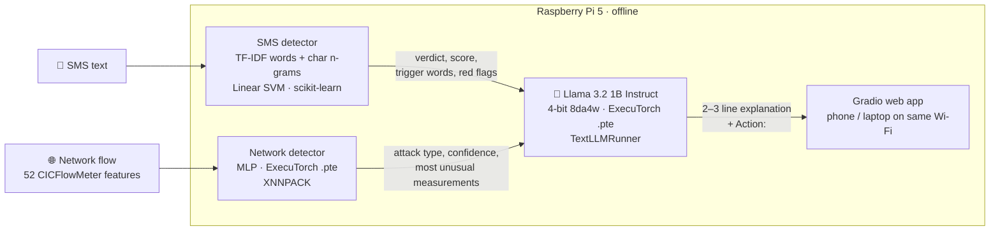

# Bharat_AI_SOC_Challenge_MIT
This contains all the necessary codes and outputs submitted for the challenge
# 🛡️ Scam & Threat Shield
### On-device SMS scam and network threat detection, explained by Llama 3.2 on ExecuTorch on a Raspberry Pi 5

> **Arm Bharat AI-SoC Challenge · Problem Statement 3: On-device threat / phishing / scam detection**
> Team: *[Name 1], [Name 2], [Name 3]* · *[College]*

Scam & Threat Shield runs **entirely on a Raspberry Pi 5** with no internet and no cloud API. It protects users in two ways:

1. **📱 SMS scam detection.** It flags fraudulent messages (fake KYC, lottery, electricity bill and phishing SMS).
2. **🌐 Network threat detection.** It flags malicious network traffic (DoS, DDoS, port scans, brute force, web attacks, botnets).

For every verdict, **Llama 3.2 1B Instruct**, quantised to 4 bits and run with **ExecuTorch**, explains *why* in plain language and recommends *what to do*.

---

## Table of contents
1. [Why on-device](#1-why-on-device)
2. [Architecture](#2-architecture)
3. [Repository structure](#3-repository-structure)
4. [Datasets](#4-datasets)
5. [Models and results](#5-models-and-results)
6. [Reproduce: train in Google Colab](#6-reproduce-train-in-google-colab)
7. [Deploy on Raspberry Pi 5](#7-deploy-on-raspberry-pi-5)
8. [Using the app](#8-using-the-app)
9. [Benchmark on the Pi](#9-benchmark-on-the-pi)
10. [Troubleshooting](#10-troubleshooting)
11. [Limitations and future work](#11-limitations-and-future-work)
12. [Credits, licences and AI-assistance disclosure](#12-credits-licences-and-ai-assistance-disclosure)

---

## 1. Why on-device

| Concern | Cloud approach | Scam & Threat Shield (on-device) |
|---|---|---|
| **Privacy** | Personal SMS (OTPs, bank alerts) and traffic data leave the device | Nothing leaves the Pi |
| **Connectivity** | Fails without internet | Works fully offline |
| **Latency** | Network round trip | Detectors answer in milliseconds |
| **Cost** | Per-request API fees and servers | One-time hardware cost |
| **Hardware** | Data-centre GPUs | Arm Cortex-A76 CPU (Raspberry Pi 5) |

---

## 2. Architecture



**Design principle: the small model decides, Llama explains.**
- The detectors are fast, small and *measurable* (98–99.9 % accuracy on held-out data). They make the decision.
- Llama never changes the verdict. It receives the verdict and the evidence (trigger words, red flags, unusual measurements) and turns them into advice a non-expert can act on. This avoids hallucinated verdicts and keeps latency low.
- Each verdict is explained using the evidence behind it:
  - **SMS:** the words with the highest *TF-IDF × SVM weight*, plus regex red flags (link, OTP/PIN, KYC/account block, UPI, prize, urgency, money, phone number).
  - **Network:** the features furthest from normal traffic, measured as signed-log z-scores against normal-traffic statistics.

---

## 3. Repository structure

```
scam-threat-shield/
├── README.md                     ← this file
├── pi_app.py                     ← Raspberry Pi app (Gradio): detect → Llama explain → recommend
├── benchmark_pi.py               ← measures latency / tokens-per-second / RAM / temperature on the Pi
├── requirements-pi.txt           ← Pi dependencies (scikit-learn 1.6.1, executorch 1.6.0, gradio …)
├── PI_STEPS.md                   ← extra-detailed beginner guide for the Pi
├── notebooks/
│   ├── 1_sms_spam_detector_colab.ipynb         ← trains + compares 6 SMS models (executed)
│   ├── 2_cicids_network_threat_detector.ipynb  ← trains network detector + exports .pte (executed)
│   └── 3_llama_export_colab.ipynb              ← exports Llama 3.2 1B Instruct to .pte (executed)
└── models/                       ← NOT in git (large / licensed). Filled on the Pi:
    ├── scam_detector.joblib      ← from sms_model_artifacts.zip
    ├── llama3_2_1b.pte           ← from notebook 3 (≈ 802 MB)
    ├── tokenizer.model           ← from notebook 3
    └── network/                  ← from network_artifacts.zip
        ├── network_mlp.pte
        ├── network_meta.json
        └── sample_flows.csv
```

Suggested `.gitignore`:
```
models/
*.pte
*.pth
*.joblib
venv/
__pycache__/
results_pi.json
```

---

## 4. Datasets

| Dataset | Used for | Size after cleaning | Classes |
|---|---|---|---|
| `combined_dataset.csv` (in `spam_sms.zip`) | SMS detector | **10,223** messages (near-duplicates removed from 10,961) | ham 7,980 · spam 2,243 (21.9 %) |
| `cicids2017_cleaned.csv` (in `cicids.zip`), **CIC-IDS2017** | Network detector | **2,497,759** unique flows, 52 numeric features | Normal, DoS, DDoS, Port Scanning, Brute Force, Web Attacks, Bots |

Notes:
- The SMS dataset combines the UCI SMS Spam Collection, other SMS messages and email spam, so it is harder than SMS-only benchmarks.
- For CIC-IDS2017 we kept 300,000 normal flows plus all 425,679 attack flows for training and testing (80/20 split, stratified). We used **300,000 further normal flows** that were never trained on to measure the false-alarm rate.

---

## 5. Models and results

All numbers below come from **our executed notebooks** in `notebooks/` (Colab CPU runtime).

### 5.1 SMS scam detector: 6 algorithms compared, best chosen automatically

Selection rule, fixed before testing: **highest mean 5-fold cross-validation F1 on the spam class.** We use F1 because only 22 % of messages are spam, so plain accuracy is misleading.

| Model (TF-IDF features) | CV F1 (5-fold) | Test accuracy | Test F1 |
|---|---|---|---|
| **Linear SVM, words + char 3–5-grams ✅** | **0.9486 ± 0.0086** | **98.04 %** | **0.9546** |
| Logistic Regression, words + char n-grams | 0.9438 | 98.00 % | 0.9535 |
| Linear SVM, words | 0.9289 | 97.46 % | 0.9409 |
| Logistic Regression, words | 0.9246 | 97.26 % | 0.9364 |
| Multinomial Naive Bayes, words | 0.9194 | 96.82 % | 0.9262 |
| Random Forest, words | 0.8559 | 94.96 % | 0.8730 |

**Chosen model (hidden test set, 2,045 messages):** accuracy **98.04 %**, precision 97.23 %, recall 93.76 %, F1 0.955. It raised **12 false alarms** out of 1,596 normal messages and **missed 28** of 449 spam. The model is 9.5 MB.

**Why Linear SVM with word + character n-grams?**
1. **Most accurate:** it has the best F1 in both cross-validation and the hidden test.
2. **Robust to spam tricks:** character n-grams still match obfuscated words like "FR33", "W1N" and "mediccationn". Adding them raised F1 by about 2 points.
3. **Suited to text:** linear SVMs generalise well with many sparse features (~134k) and few examples (~8k).
4. **Edge-friendly and explainable:** it takes milliseconds on a CPU, and every word has a weight, which gives us trigger words for Llama.

### 5.2 Network threat detector (CIC-IDS2017)

| Model | Accuracy | Macro F1 | Attack recall | False alarms on 300k unseen normal flows | Size | Latency per flow |
|---|---|---|---|---|---|---|
| HistGradientBoosting (scikit-learn) | **99.89 %** | **98.93 %** | **99.98 %** | **0.19 %** | 447 KB | 3.8 ms |
| **MLP 52→128→64→7 on ExecuTorch (`network_mlp.pte`) ✅ deployed** | 99.47 % | 93.16 % | – | – | **66 KB** | **0.096 ms** |

- The `.pte` output matched PyTorch within **2.7 × 10⁻⁹**.
- The Pi uses the **ExecuTorch MLP**. It is ExecuTorch-native, 7× smaller and 40× faster than the tree model, and needs no scikit-learn version match. HistGradientBoosting is reported as the accuracy reference.
- Weakest classes (MLP): Bots and Web Attacks, the two rarest classes.

### 5.3 Llama 3.2 1B Instruct on ExecuTorch

| Item | Value |
|---|---|
| Export | `export_llm`, KV cache + SDPA, **8da4w** (4-bit weights, 8-bit dynamic activations, group 128), 4-bit embeddings, **XNNPACK**, max sequence 1,024 |
| `.pte` size | **802 MB** |
| Speed on Colab CPU | **9.8 tokens/s** (SMS), **8.8 tokens/s** (network), ~18–22 s for 95 tokens |
| Speed on Raspberry Pi 5 | **TODO**: run `python benchmark_pi.py` |
| Decoding | Greedy (temperature 0), max 80 new tokens, so output is repeatable |

### 5.4 Raspberry Pi 5 results (fill in after running `benchmark_pi.py`)

| Metric | Raspberry Pi 5 |
|---|---|
| SMS detector latency (mean / p95) | **TODO** ms / **TODO** ms |
| Network detector latency, ExecuTorch (mean) | **TODO** ms |
| Llama decode speed | **TODO** tokens/s |
| Llama time to first token | **TODO** s |
| Llama time per explanation | **TODO** s |
| RAM used by the whole app | **TODO** MB |
| CPU temperature start → end | **TODO** |

---

## 6. Reproduce: train in Google Colab

All three notebooks run on the **free Colab CPU runtime**. Open each one with **colab.research.google.com → File → Upload notebook**, then **Runtime → Run all**.

| Step | Notebook | Input (in Google Drive) | Output (download) | Time |
|---|---|---|---|---|
| 1 | `1_sms_spam_detector_colab.ipynb` | `spam_sms.zip` | `sms_model_artifacts.zip` → `scam_detector.joblib`, `metrics.json` | ~5 min |
| 2 | `2_cicids_network_threat_detector.ipynb` | `cicids.zip` | `network_artifacts.zip` → `network_mlp.pte`, `network_meta.json`, `sample_flows.csv`, … | ~10 min |
| 3 | `3_llama_export_colab.ipynb` | Hugging Face token with access to `meta-llama/Llama-3.2-1B-Instruct` | Drive `llama_pte/` → `llama3_2_1b.pte`, `tokenizer.model` | ~20–30 min |

**Notes:**
- **Llama access:** request it at huggingface.co/meta-llama/Llama-3.2-1B-Instruct. Create a **Read** token under *Settings → Access Tokens* and paste it when notebook 3 asks. Never commit the token.
- **scikit-learn version:** notebook 1 ran with **scikit-learn 1.6.1**, and the Pi installs exactly that version so `scam_detector.joblib` loads unchanged. The network model runs as an ExecuTorch `.pte`, so it needs no scikit-learn on the Pi.

---

## 7. Deploy on Raspberry Pi 5

**Hardware:** Raspberry Pi 5 (8 GB recommended, 4 GB works), official power supply, 32 GB+ microSD, active cooler, Wi-Fi.
**OS:** Raspberry Pi OS **64-bit**. ExecuTorch has no 32-bit build.

### 7.1 Flash the OS
1. Install **Raspberry Pi Imager** on your laptop.
2. Choose **Raspberry Pi 5 → Raspberry Pi OS (64-bit)**, then your SD card.
3. Under **Edit settings**, set a username and password and your Wi-Fi, and on the **Services** tab enable **SSH**.
4. Write the card, insert it in the Pi and power on.

### 7.2 Copy your files (USB drive)
Put these on a USB drive: `sms_model_artifacts.zip`, `network_artifacts.zip`, `llama3_2_1b.pte`, `tokenizer.model`, and this repo's `pi_app.py`, `benchmark_pi.py`, `requirements-pi.txt`.

On the Pi, open **Terminal**. Run `ls /media/$USER` to see the drive name, and replace `USBNAME` below with it:
```bash
mkdir -p ~/soc/models/network && cd ~/soc
cp /media/$USER/USBNAME/{pi_app.py,benchmark_pi.py,requirements-pi.txt} ~/soc/
cp /media/$USER/USBNAME/llama3_2_1b.pte /media/$USER/USBNAME/tokenizer.model ~/soc/models/
unzip -o /media/$USER/USBNAME/sms_model_artifacts.zip -d ~/soc/models/
unzip -o /media/$USER/USBNAME/network_artifacts.zip  -d ~/soc/models/network/
```
The app finds each file by name anywhere under `models/`, so an extra sub-folder from unzipping is fine.

### 7.3 Install
```bash
cd ~/soc
python3 -m venv venv
source venv/bin/activate
pip install --upgrade pip
pip install torch==2.15.0 --index-url https://download.pytorch.org/whl/cpu   # small CPU-only PyTorch
pip install -r requirements-pi.txt
python -c "import sklearn, executorch, gradio; print('OK, scikit-learn', sklearn.__version__)"   # must print 1.6.1
```
> executorch 1.6.0, torch 2.15.0 and scikit-learn 1.6.1 all publish **aarch64** wheels for Python 3.11 and 3.13. On aarch64 Linux, executorch does not force a newer scikit-learn, so 1.6.1 stays installed. If the CPU-only PyTorch line fails, skip it: the next line installs the standard build, which is a larger download.

### 7.4 Run
```bash
cd ~/soc && source venv/bin/activate
python pi_app.py
```
Wait for `Loaded SMS model … Llama in …s` and `Running on local URL: http://0.0.0.0:7860`.

### 7.5 Open from a phone or laptop
1. On the Pi, run `hostname -I` and note the first address, e.g. `192.168.1.42`.
2. On any device on the **same Wi-Fi**, open **`http://192.168.1.42:7860`**.

---

## 8. Using the app

| Tab | What you do | What you get |
|---|---|---|
| **📱 SMS** | Paste a message (or tap an example) → **Check** | 🚨 Scam / ⚠️ Suspicious / ✅ Safe, scam probability, trigger words, red flags, **Llama's explanation + "Action:"** |
| **🌐 Network** | Pick a sample flow number (0–69), or upload a CSV with the 52 CIC-IDS2017 columns → **Check** | Attack type and confidence, the most unusual measurements vs. normal traffic, **Llama's explanation + "Action:"** |

Every result shows **detector time, Llama time, tokens/s and RAM**, measured live on the Pi.

---

## 9. Benchmark on the Pi
```bash
cd ~/soc && source venv/bin/activate
python benchmark_pi.py
```
It prints a **RESULTS** block and saves `results_pi.json`, which contains:
- SMS detector latency (200 runs, mean and p95)
- Network `.pte` latency and accuracy on the 70 sample flows
- Llama tokens/s, time to first token and time per explanation (3 SMS + 2 network)
- Model load times, file sizes, RAM, and CPU temperature (`vcgencmd`)

Copy these into section 5.4 and into the technical report.

---

## 10. Troubleshooting

| Problem | Fix |
|---|---|
| `scam_detector.joblib not found` | Re-run `unzip … sms_model_artifacts.zip -d ~/soc/models/` |
| `network_meta.json not found` | Re-run `unzip … network_artifacts.zip -d ~/soc/models/network/` |
| Log says Llama **NOT FOUND** | `ls ~/soc/models` must show `llama3_2_1b.pte` and `tokenizer.model` |
| `ModuleNotFoundError` | Activate the environment: `source ~/soc/venv/bin/activate` |
| `InconsistentVersionWarning` (scikit-learn) | `pip install scikit-learn==1.6.1` |
| `No matching distribution found for executorch` | You're on 32-bit OS. Re-flash **64-bit** Raspberry Pi OS |
| Slow or freezing | Use the 8 GB Pi with active cooling, and open the app from a phone instead of the Pi's own browser |
| Phone can't connect | Phone and Pi must be on the same Wi-Fi. Check the IP with `hostname -I` |

---

## 11. Limitations and future work

- **SMS data:** the training data is mostly English and partly email. Genuine bank OTP and UPI alerts can be flagged as scams. *Next:* Indian and Hindi/Hinglish SMS, and verified sender-ID whitelists.
- **Network data:** CIC-IDS2017 was recorded in a 2017 lab, so accuracy on real home networks will be lower. Live use needs a flow extractor (CICFlowMeter) producing the same 52 features. *Next:* live capture on the Pi's network interface.
- **Llama quality:** a 1B model can occasionally give generic or imperfect wording. We mitigate this by passing only detector evidence, using a strict prompt and greedy decoding, and falling back to a template if Llama is unavailable.
- **Interface:** users paste messages manually. *Next:* an Android app using ExecuTorch's Android runtime to scan incoming SMS with the user's permission.

---

## 12. Credits, licences and AI-assistance disclosure

- **Llama 3.2** © Meta, used under the Llama 3.2 Community License. *Built with Llama.* Model weights and `.pte` files are **not** redistributed in this repository.
- **ExecuTorch**, **PyTorch** (BSD licence), **scikit-learn** (BSD), **Gradio** (Apache 2.0).
- **CIC-IDS2017:** I. Sharafaldin, A. H. Lashkari, A. A. Ghorbani, *Toward Generating a New Intrusion Detection Dataset and Intrusion Traffic Characterization*, ICISSP 2018. Canadian Institute for Cybersecurity.
- **UCI SMS Spam Collection:** T. A. Almeida, J. M. Gómez Hidalgo, UCI Machine Learning Repository (CC BY 4.0), part of the combined SMS dataset. Check the licence of the combined dataset before redistributing it.
- **AI assistance:** parts of the code and documentation were drafted with the help of an AI assistant and were reviewed, run and tested by the team. *[Check the challenge rules on AI-assisted work and edit this line as required.]*
